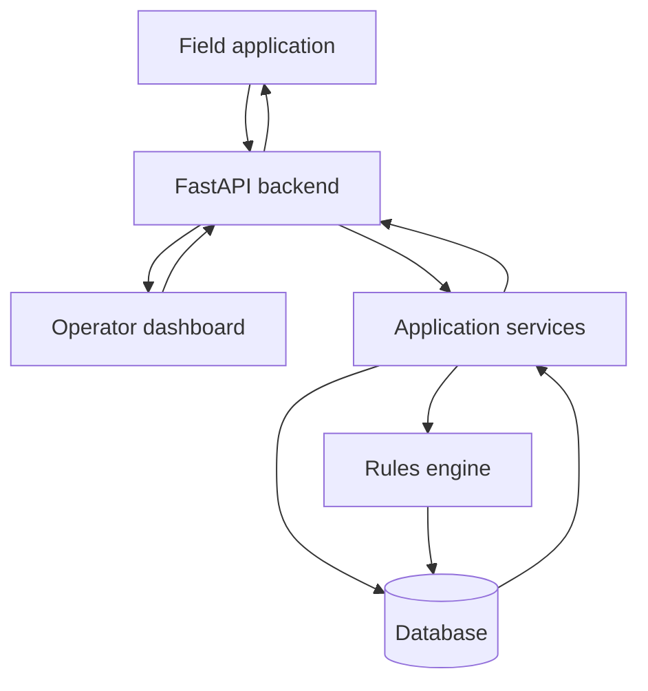

# Architecture

This page describes the main components of GridFit and how information moves between the field application, operator dashboard, backend API, assessment engine and database.

## Core principles

GridFit follows these architectural principles:

- **Rules-based assessment:** Feasibility assessments use defined rules and business and site inputs.
- **Separation of responsibilities:** The frontend handles user interaction, the backend manages application logic and data, and the rules engine performs technical assessments.
- **Organisation-scoped access:** Authenticated users access records belonging to their organisation.
- **Traceability:** Scenario records preserve assessment inputs and results for later review.
- **Data quality:** Assessment results depend on the completeness of business, site and metering information.
- **Operator decision-making:** GridFit supports decisions but does not replace operator judgement.

## Component breakdown

### Frontend application

GridFit uses Next.js and React for its frontend application. It provides two main interfaces:

- **Field application:** Supports field operators in registering businesses, recording equipment and managing meter assignments.
- **Operator dashboard:** Supports mini-grid operators in reviewing sites, prospects, fit checks, comparisons and assessment scenarios.

The frontend communicates with the backend through HTTP API requests.

### Backend API

The backend uses FastAPI to expose REST endpoints.

| Router | Responsibility |
|---|---|
| Authentication | User authentication |
| Businesses | Business records and profiles |
| Sites | Mini-grid site records |
| Site profiles | Site data and monitoring imports |
| Sensor devices | Device registration and status |
| Meter assignments | Meter assignment management |
| Scenarios | Assessment creation and retrieval |

### Application services

The service layer contains application logic between API routes and repositories. It manages business records, site information, profiles, meter assignments and scenario operations.

### Rules engine

The rules engine evaluates business demand against available site information and assessment constraints. It returns feasibility outcomes and supporting assessment results.

See [Rules Engine](rules-engine.md) for further details.
## System architecture

The diagram shows the application layers and request flow. It does not represent a confirmed live sensor-to-backend telemetry connection.

## Data layer

GridFit uses a relational database to persist application records and support traceability across the assessment workflow.

The main data entities include:

- **Organisation and users:** Identify organisations and their authorised users.
- **Sites:** Represent mini-grid locations managed by an organisation.
- **Site profiles:** Store site capacity and related assessment information.
- **Businesses:** Store business details and operational information.
- **Sensor devices:** Represent registered monitoring devices.
- **Meter assignments:** Associate meters with businesses.
- **Readings:** Store recorded metering observations.
- **Scenarios:** Store assessment runs and their results.
- **Scenario businesses:** Associate businesses with assessment scenarios.

## Data flow

The main assessment workflow follows these steps:

1. A field agent registers a business and records its equipment.
2. A meter is assigned to the business.
3. Meter readings contribute to the business's recorded demand profile.
4. An operator initiates a scenario using the relevant business and site information.
5. The backend service prepares the assessment inputs and invokes the rules engine.
6. The assessment result is stored for review.
7. The operator uses the result to support a business-placement or capacity decision.

The completeness and reliability of an assessment depend on the quality of the available business, site and metering information.

## Security and access boundaries

GridFit uses authenticated access and organisation-scoped data operations. Users should only access records permitted by their organisation and assigned role.

API routes, application services and repositories work together to enforce these access boundaries.

## Main entity relationships

The database entities support the following relationships:

- An organisation has users and manages sites and businesses.
- A site can have associated site profiles.
- A business can have meter assignments and associated readings.
- Sensor devices are registered and managed within the monitoring workflow.
- Scenarios contain assessment records for businesses.
- Scenario-business associations connect assessed businesses to their scenarios.

These relationships support organisation-level data management, monitoring and assessment traceability.
