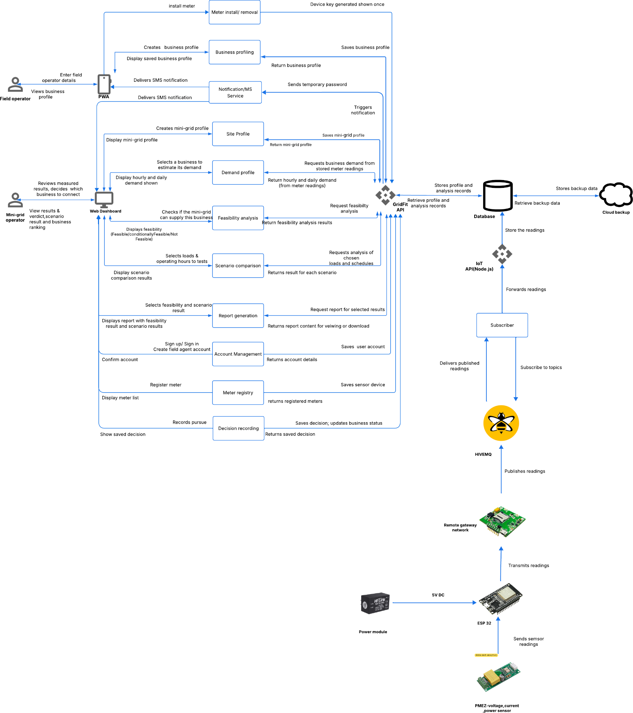
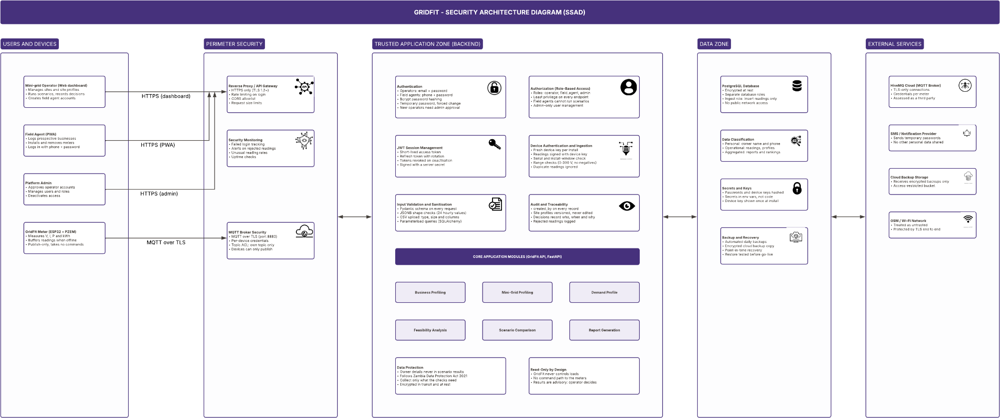

# System Architecture

## Purpose of the architecture

GridFit is designed to help mini-grid operators assess whether a business can be supported by the available electricity capacity at a site. It brings together site information, business demand, metering evidence, deterministic assessment checks, scenario comparison and decision recording in one operator workflow.

The architecture separates the user-facing applications from the API, persistence layer and assessment logic. This allows field and operator workflows to use shared backend services while keeping validation, organisation-scoped access and assessment rules centralised.

The diagrams on this page describe the supplied GridFit architecture and workflow material. They should be read alongside the implementation boundaries noted below: a component shown in an architecture or device-flow diagram is not, by itself, proof that its complete runtime integration is implemented.

## System architecture diagram

The system architecture diagram provides the high-level view of the GridFit ecosystem. It shows the field and operator interfaces, application modules, API, database and the illustrated metering-data path.

The main application path runs from the field/operator interfaces through the API to the application services and database. The diagram identifies the main functional areas as business profiling, mini-grid/site profiling, demand profiling, feasibility analysis, scenario comparison, report generation, account management, meter registry and decision recording.

The diagram also includes a device-data path involving an ESP32, a power sensor, a remote gateway, HiveMQ and an IoT API. This is an architectural representation of the intended or demonstrated telemetry flow; it must not be interpreted as proof that production device firmware, end-to-end ingestion or live meter-to-assessment integration is complete.

## Secure system architecture

The security architecture diagram overlays security controls and trust boundaries on the application structure. It groups the system into users and devices, perimeter security, the trusted application zone, the data zone and external services.

The diagram identifies the following security areas:

- **Identity and access:** operator, field-agent and administrator access, authentication and role-based permissions.
- **Perimeter protection:** HTTPS entry points, reverse-proxy/API-gateway controls, request-size limits and rate limiting.
- **Application safeguards:** input validation, sanitisation, device authentication, audit and traceability.
- **Data protection:** database access restrictions, data classification, secrets management, backups and recovery.
- **External-service boundaries:** MQTT broker, notification provider, cloud backup and network services.

These are the controls represented in the supplied security design. Their presence in the diagram should not be treated as independent verification that every control is deployed, configured or penetration-tested in the current environment.

## Components and responsibilities

The GridFit architecture is organised into four connected areas, from the interfaces used by people in the field to the services that support assessment and decision-making.

  <article class="gf-component-card">
    USER INTERFACES
    <h3>Operator web dashboard</h3>
    
Manages mini-grid sites, business profiles, assessments, scenarios, reports and recorded decisions.

  </article>

  <article class="gf-component-card">
    USER INTERFACES
    <h3>Field Progressive Web App (PWA)</h3>
    
Supports field-agent workflows for collecting business and equipment information and supporting meter installation.

  </article>

  <article class="gf-component-card">
    APPLICATION SERVICES
    <h3>FastAPI backend</h3>
    
Exposes application endpoints, validates requests, enforces access rules and coordinates business logic.

  </article>

  <article class="gf-component-card">
    APPLICATION SERVICES
    <h3>Business profiling</h3>
    
Creates and retrieves business profiles used in demand assessment.

  </article>

  <article class="gf-component-card">
    APPLICATION SERVICES
    <h3>Site and mini-grid profiling</h3>
    
Maintains site information and the capacity context used during assessment.

  </article>

  <article class="gf-component-card">
    APPLICATION SERVICES
    <h3>Demand profiling</h3>
    
Builds business demand profiles using submitted business information and available metering evidence.

  </article>

  <article class="gf-component-card">
    ASSESSMENT &amp; DECISIONS
    <h3>Feasibility analysis</h3>
    
Runs deterministic checks against available site capacity and business demand.

  </article>

  <article class="gf-component-card">
    ASSESSMENT &amp; DECISIONS
    <h3>Scenario comparison</h3>
    
Compares assessment outcomes under selected loads and operating schedules.

  </article>

  <article class="gf-component-card">
    ASSESSMENT &amp; DECISIONS
    <h3>Report generation</h3>
    
Prepares assessment and scenario results for review or download.

  </article>

  <article class="gf-component-card">
    ASSESSMENT &amp; DECISIONS
    <h3>Decision recording</h3>
    
Stores the operator's decision and associated business-status update.

  </article>

  <article class="gf-component-card">
    DATA &amp; INTEGRATION
    <h3>Meter registry</h3>
    
Maintains meter and device registration and assignment records.

  </article>

  <article class="gf-component-card">
    DATA &amp; INTEGRATION
    <h3>Notification service</h3>
    
Supports account or workflow notifications, as represented in the architecture.

  </article>

  <article class="gf-component-card">
    DATA &amp; INTEGRATION
    <h3>Database</h3>
    
Persists application records and their relationships.

  </article>

  <article class="gf-component-card gf-component-card--qualified">
    DATA &amp; INTEGRATION
    <h3>Telemetry components</h3>
    
Represent the proposed or demonstrated sensor-to-platform data path. Their implementation status is qualified in the sections below.

  </article>

## Data and workflow flow

The GridFit workflow connects site preparation, business registration, metering evidence, demand assessment and an operator decision.

1. **Set up a mini-grid site.** The operator establishes the site profile and the technical information required for assessment.
2. **Register a business.** A field agent collects business details and operating information through the field workflow.
3. **Associate metering evidence.** Meter records and readings provide evidence where available and correctly associated.
4. **Build the business demand profile.** The platform uses the available business and metering information to represent expected demand.
5. **Run an assessment.** The assessment engine evaluates demand against the mini-grid/site information using deterministic checks.
6. **Review results and record a decision.** The operator reviews the feasibility outcome, may compare scenarios, and records whether to pursue the business connection.

The assessment result is advisory decision support. It does not itself connect a business or control generation, batteries, inverters or electrical loads.

## User workflow

The following diagram shows the detailed user journey across account access, field-agent business capture and the operator assessment workflow.

```mermaid
%%{init: {"theme":"base","themeVariables":{"primaryColor":"#F1EBFA","primaryTextColor":"#30204F","primaryBorderColor":"#9B8FC0","lineColor":"#776A91","secondaryColor":"#FFF0E4","tertiaryColor":"#E7F5E9","background":"#F6F2FC","fontFamily":"Nunito Sans, sans-serif","fontSize":"16px"}}}%%
flowchart LR

    subgraph access["1. ACCOUNT ACCESS"]
        direction TB
        START([Start]) --> EXISTS{"User account exists?"}
        EXISTS -- No --> CREATE["Create account"]
        EXISTS -- Yes --> LOGIN["Log in"]
        CREATE --> LOGIN
        LOGIN --> AGENT["Create or access field-agent account"]
        AGENT --> VERIFY["Complete account verification"]
    end

    subgraph field["2. FIELD-AGENT BUSINESS CAPTURE"]
        direction TB
        VERIFY --> BASIC["Fill in basic business information"]
        BASIC --> LOCATION["Add business location"]
        LOCATION --> DETAILS["Enter business and equipment details"]
        DETAILS --> METER{"Meter or readings available?"}
        METER -- Yes --> CAPTURE["Capture available meter information"]
        METER -- No --> MISSING["Record available information and identify missing evidence"]
        CAPTURE --> REVIEW["Review field submission"]
        MISSING --> REVIEW
        REVIEW --> SUBMIT["Submit business profile"]
    end

    subgraph assessment["3. RULES-BASED ASSESSMENT"]
        direction TB
        SUBMIT --> LOAD["Load business profile and available metering evidence"]
        LOAD --> VALIDATE["Validate input completeness and consistency"]
        VALIDATE --> PROFILE["Build business demand profile"]
        PROFILE --> CHECK["Run deterministic capacity and demand checks"]
        CHECK --> RESULT["Generate assessment outcome"]
    end

    subgraph operator["4. OPERATOR REVIEW AND DECISION"]
        direction TB
        RESULT --> DASH["Open operator dashboard"]
        DASH --> VIEW["Review business details and assessment"]
        VIEW --> OUTCOME{"Assessment outcome?"}
        OUTCOME -- Feasible --> FEASIBLE["Record feasible decision"]
        OUTCOME -- Conditionally feasible --> CONDITIONAL["Record conditional decision"]
        OUTCOME -- Not feasible --> NOTFEASIBLE["Record not-feasible decision"]
        FEASIBLE --> SAVE["Save operator decision"]
        CONDITIONAL --> SAVE
        NOTFEASIBLE --> SAVE
        SAVE --> FINISH([End])
    end

    classDef startEnd fill:#DDF4E1,stroke:#39B85A,color:#174D29,stroke-width:2px
    classDef process fill:#F5F1FC,stroke:#8F7DB8,color:#30204F,stroke-width:1.5px
    classDef decision fill:#FFF1D6,stroke:#E99A16,color:#563800,stroke-width:2px
    classDef warning fill:#FFF0E4,stroke:#F47721,color:#71350D,stroke-width:1.5px
    classDef success fill:#E7F5E9,stroke:#55966A,color:#214B2D,stroke-width:1.5px

    class START,FINISH startEnd
    class CREATE,LOGIN,AGENT,VERIFY,BASIC,LOCATION,DETAILS,CAPTURE,REVIEW,SUBMIT,LOAD,VALIDATE,PROFILE,CHECK,RESULT,DASH,VIEW,SAVE process
    class EXISTS,METER,OUTCOME decision
    class MISSING,CONDITIONAL,NOTFEASIBLE warning
    class FEASIBLE success
```

The workflow diagram should be used as a process view: it describes the sequence of user actions and decision points rather than the internal deployment topology of the software.

## Architecture layers

The system can be understood through four logical layers.

### 1. Presentation layer

The presentation layer contains the browser-based operator dashboard and the field-agent PWA. The operator interface supports site and business review, assessment, scenario comparison, reporting and decision recording. The field workflow supports business registration, equipment information and meter-installation activities.

### 2. Application and API layer

The FastAPI backend is the application boundary between the interfaces and persisted data. It receives requests, validates input, applies role and organisation-scoping rules, invokes application services and returns structured responses.

The application modules represented in the architecture include business profiling, site profiling, demand profiling, feasibility analysis, scenario comparison, report generation, meter registry, account management and decision recording.

### 3. Assessment and data layer

The assessment layer contains the deterministic rules and simulation logic used to evaluate business demand against site capacity. The data layer stores the records required by the workflows, including organisations, users, sites, businesses, meter assignments/readings, profiles, scenarios and decisions, according to the supplied implementation documentation.

The assessment result is based on the quality, completeness and provenance of the available inputs. Missing or estimated information should remain visible during review.

### 4. Integration and device-data layer

The diagrams show integrations for notifications, database backup and an MQTT-based telemetry route. The device-flow diagram illustrates a sensor connected to an ESP32, a remote gateway and a message broker before readings are forwarded toward the platform.

```mermaid
%%{init: {"theme":"base","themeVariables":{"primaryColor":"#F1EBFA","primaryTextColor":"#30204F","primaryBorderColor":"#9B8FC0","lineColor":"#776A91","secondaryColor":"#FFF0E4","tertiaryColor":"#E7F5E9","background":"#F6F2FC","fontFamily":"Nunito Sans, sans-serif","fontSize":"16px"}}}%%
flowchart LR

    subgraph setup["1. DEVICE SETUP AND MEASUREMENTS"]
        direction TB
        START([Start]) --> PROFILE["Prepare energy profile"]
        PROFILE --> ASSOCIATE["Associate profile with business or site"]
        ASSOCIATE --> OPERATIONAL{"Device operational?"}
        OPERATIONAL -- No --> TROUBLE["Troubleshoot or replace sensor"]
        TROUBLE --> OPERATIONAL
        OPERATIONAL -- Yes --> REGISTER["Register or commission device"]
        REGISTER --> CAPTURE["Capture energy readings"]
        CAPTURE --> VALID{"Readings complete and valid?"}
        VALID -- No --> CHECK["Check sensor and configuration"]
        CHECK --> CAPTURE
    end

    subgraph local["2. LOCAL PROCESSING AND DATA PREPARATION"]
        direction TB
        VALID -- Yes --> RECEIVE["Receive and record incoming readings"]
        RECEIVE --> NORMALIZE["Create normalized records"]
        NORMALIZE --> INTERVAL["Build interval load profile"]
        INTERVAL --> NETWORK{"Network connectivity available?"}
        NETWORK -- No --> STORE["Keep readings locally"]
        STORE --> RETRY["Retry connection"]
        RETRY --> NETWORK
        NETWORK -- Yes --> PREPARE["Prepare data for transmission"]
    end

    subgraph transmission["3. TRANSMISSION AND GRIDFIT ANALYSIS"]
        direction TB
        PREPARE --> GATEWAY["Send measurements through gateway"]
        GATEWAY --> BROKER["Publish readings through MQTT"]
        BROKER --> SUCCESS{"Transmission successful?"}
        SUCCESS -- No --> RESYNC["Retry synchronisation with server"]
        RESYNC --> GATEWAY
        SUCCESS -- Yes --> BACKEND["GridFit backend receives data"]
        BACKEND --> END([End])
    end

    classDef startEnd fill:#DDF4E1,stroke:#39B85A,color:#174D29,stroke-width:2px
    classDef process fill:#F5F1FC,stroke:#8F7DB8,color:#30204F,stroke-width:1.5px
    classDef decision fill:#FFF1D6,stroke:#E99A16,color:#563800,stroke-width:2px
    classDef warning fill:#FFF0E4,stroke:#F47721,color:#71350D,stroke-width:1.5px
    classDef success fill:#E7F5E9,stroke:#55966A,color:#214B2D,stroke-width:1.5px

    class START,END startEnd
    class PROFILE,ASSOCIATE,REGISTER,CAPTURE,RECEIVE,NORMALIZE,INTERVAL,PREPARE,GATEWAY,BROKER,BACKEND process
    class OPERATIONAL,VALID,NETWORK,SUCCESS decision
    class TROUBLE,CHECK,STORE,RETRY,RESYNC warning
```

This device-flow diagram is a reference for the intended telemetry path. The supplied implementation evidence does not establish a complete production path covering device firmware, secure provisioning, MQTT ingestion, validation, persistence and automatic use of live readings in assessment. Where readings are imported or otherwise supplied to the platform, their source and status should be clear.

## Device and telemetry flow

The device diagram represents the following sequence:

1. A power sensor measures electrical values.
2. The ESP32 receives sensor readings and is powered by the illustrated power module.
3. The ESP32 transmits readings through a remote gateway network.
4. The gateway publishes readings to the HiveMQ MQTT broker.
5. A subscriber receives messages for the configured topics.
6. An IoT API is shown forwarding readings toward the database.

The sequence is an architectural flow depiction, not a claim that all six stages are currently operational in the deployed GridFit system. In particular, do not describe the platform as having verified live telemetry ingestion unless the device, broker, subscriber, API and persistence path has been tested end to end.

## Security and access boundaries

The security design identifies separate user roles and protected application zones. The backend is responsible for enforcing access permissions; hiding an interface control alone is not an access-control mechanism.

The design also identifies HTTPS, authentication, role-based access, request validation, device authentication, audit records, secrets handling and backup/recovery as relevant controls. Deployment status and test evidence should be recorded separately from the architecture diagram.

## Implementation status and evidence boundaries

The architecture combines implemented application capabilities with an illustrated device/telemetry design. Keep these distinctions clear when presenting the system:

- The web and field interfaces communicate with the backend API.
- The backend contains application workflows and deterministic assessment logic.
- The data model includes meter and reading-related records.
- The supplied device-flow diagram illustrates an ESP32/sensor-to-gateway/MQTT/API path.
- The diagram alone does not prove production device firmware, live MQTT ingestion, automated reading persistence or end-to-end telemetry integration.
- GridFit provides assessment and decision support; it does not automatically approve a connection or control electrical infrastructure.

For implementation claims, use the corresponding backend, frontend, test and deployment documentation as the source of truth. Update this page when a diagrammed integration becomes implemented and has supporting test evidence.

## Implementation status matrix

The table below reflects the current evidence from the actual backend and frontend repositories. It separates the implementation status of the documented architecture from the design intent shown in the diagrams.

| Component | Status | Evidence basis | Notes |
|---|---|---|---|
| Backend | Verified | `techara-backend/main.py`, `database.py`, `core/security.py`, routers and services | Real FastAPI service, DB wiring, JWT auth, assignment workflows and route registration exist. |
| Frontend Web | Prototype / Mock | `techara-frontend/README.md`, `app/providers.js`, `app/(auth)/login/page.js` | The frontend uses mock data and in-memory state; it is not yet a verified backend-integrated production UI. |
| Field App | Prototype / Mock | `techara-frontend/README.md`, `app/providers.js` | The field experience is demo-oriented and not proven as a persistent backend workflow. |
| Authentication | Verified | `techara-backend/core/dependencies.py`, `tests/test_auth.py` | Bearer JWT auth and role checks are implemented for protected backend routes. |
| Meter Assignment | Verified | `techara-backend/services/meter_assignment_service.py`, `routers/meter_assignments.py` | Active-device and conflict checks are implemented in source. |
| Device Telemetry | Partially Verified | `techara-backend/models/reading.py`, `models/meter_assignment.py` | The data model exists, but live device firmware, secure transport and end-to-end ingestion are not evidenced in the inspected repositories. |
| Security | Partially Verified | `techara-backend/core/dependencies.py`, `routers/sensor_devices.py` | Core auth exists, but route protection is inconsistent on sensor-device endpoints and must be fixed before production. |
| Deployment | Partially Verified | backend/frontend GitHub workflows | CI and backend deployment automation are present, but production hosting is not verified from the inspected source. |

The architecture combines implemented application capabilities with design representations of device and telemetry flows. Keep these distinctions clear when presenting the system:

- The web and field interfaces communicate with the backend API.
- The backend contains application workflows and deterministic assessment logic.
- The data model includes meter and reading-related records.
- The supplied device-flow diagram illustrates an ESP32/sensor-to-gateway/MQTT/API path.
- The diagram alone does not prove production device firmware, live MQTT ingestion, automated reading persistence or end-to-end telemetry integration.
- GridFit provides assessment and decision support; it does not automatically approve a connection or control electrical infrastructure.

For implementation claims, use the corresponding backend, frontend, test and deployment documentation as the source of truth. Update this page when a diagrammed integration becomes implemented and has supporting test evidence.
