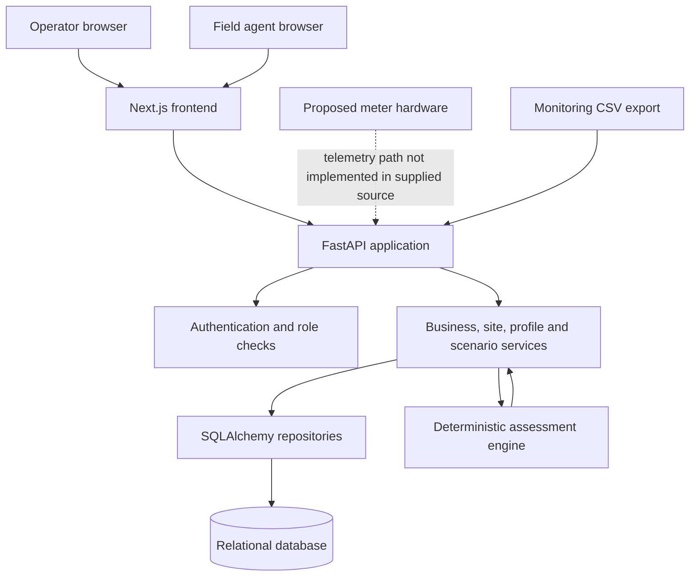
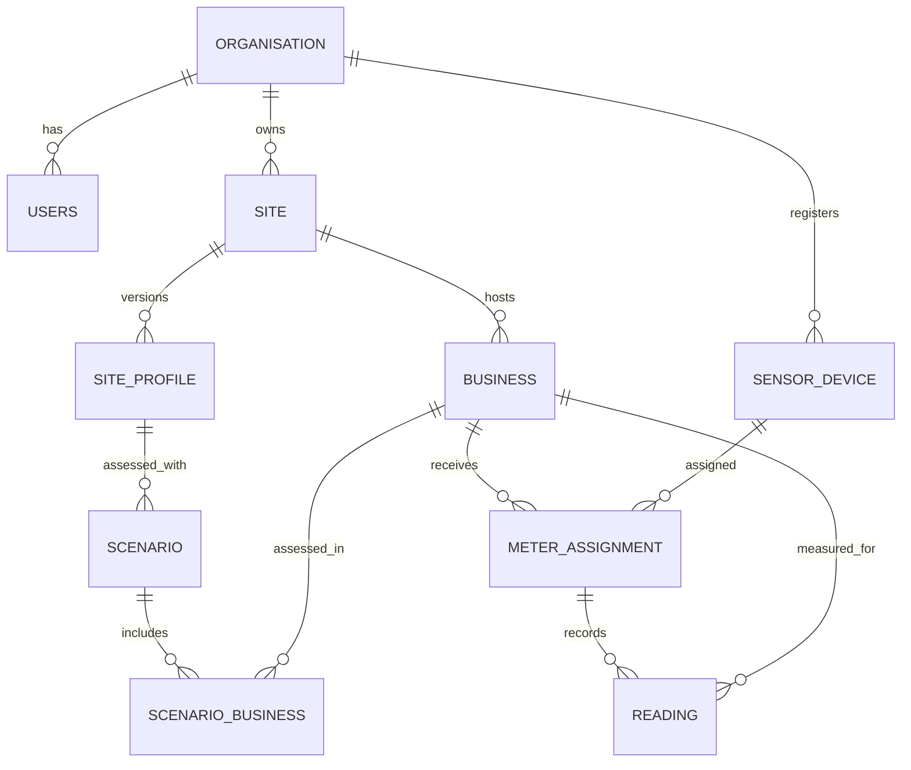

# Architecture

GridFit is organised as a browser-based frontend, a Python API, a relational data layer and a deterministic assessment engine. The metering schema is present in the backend, but the supplied source does not include a complete telemetry ingestion path or device firmware.

## Core principles

- **Decision support, not control:** the platform calculates and presents assessments; it does not operate electrical equipment.
- **Deterministic results:** given the same input snapshot and software version, the rules engine follows the same calculation path.
- **Traceable assumptions:** site profiles carry data labels and versions; scenarios store an input snapshot and simulation trace.
- **Organisation boundaries:** user-facing services scope most business and site operations to the authenticated user's organisation.
- **Incremental integration:** the frontend, API and proposed metering hardware are separate deliverables and should not be described as fully integrated until verified.

## Logical component diagram

## Component breakdown

| Component | Responsibility | Implementation evidence |
|---|---|---|
| Operator/field frontend | Browser screens for operator and field workflows | Next.js App Router, React, CSS modules and shared components |
| API application | HTTP endpoints, validation and response serialisation | FastAPI routers and Pydantic schemas |
| Authentication | Password login, bearer JWT validation and role checks | `routers/auth.py`, `core/security.py`, `core/dependencies.py` |
| Business/site services | Organisation-scoped business and site operations | `services/businesses.py`, `services/site_service.py` |
| Site-profile service | Profile creation, versioning, monitoring CSV import and spare-capacity calculations | `services/site_profile_service.py` |
| Assessment engine | Demand checks and multi-day simulation | `engine/` |
| Persistence | Relational entities and constraints | SQLAlchemy models and Alembic migrations |
| Informational website | Public-facing product website | Separate Vite/React project |
| Metering device | Intended source of business load readings | Reading/device/assignment models exist; firmware and ingestion endpoint were not present in the supplied source |

## Backend request flow

1. FastAPI receives a request through a router registered in `main.py`.
2. Pydantic validates request fields and types.
3. Protected endpoints resolve the bearer token to an active user and apply role checks.
4. A service coordinates the operation and uses repository functions to access SQLAlchemy models.
5. Scenario services prepare business profiles and convert the selected site profile into the engine's input shape.
6. The engine runs the checks and simulation.
7. The service persists the scenario and returns a response schema.

## Main data relationships

`Reading` references both `assignment_id` and `business_id`; a composite foreign-key constraint requires the business to match the referenced assignment. A unique constraint prevents two readings for the same assignment at the same `measured_at` timestamp.

## Data flow

### Business and scenario flow

Business information is stored against a site. The business profile service retrieves the business's readings, converts timestamps into the configured local timezone and builds 24-hour average and peak power arrays. The scenario service requires the minimum observed-day threshold configured in the site profile, then passes the prepared businesses and site data to the engine.

### Site monitoring import

An operator can submit CSV text with a source timezone and optional column mapping. The site-profile service parses the export and returns suggested baseline demand, solar profile, settings and data labels. This import response is a preparation step; the operator must create or update a profile with validated values.

### Metering path

The database includes sensor devices, meter assignments and readings. Meter installation creates a random device token, stores its SHA-256 hash and returns the raw token in the creation response. However, no reading ingestion router, request schema or firmware was found in the supplied backend archive. The architecture diagram therefore marks the device-to-API path as planned/not verified rather than implemented.

## Scalability and operational boundaries

The API is a conventional synchronous FastAPI/SQLAlchemy application. The supplied code does not demonstrate a queue, streaming broker, distributed worker, telemetry message bus or automatic horizontal-scaling configuration. Any such infrastructure should be documented only after it is added and deployed. The engine's 24-hour arrays and scenario period are bounded by schema constraints, which helps keep individual assessments predictable.
