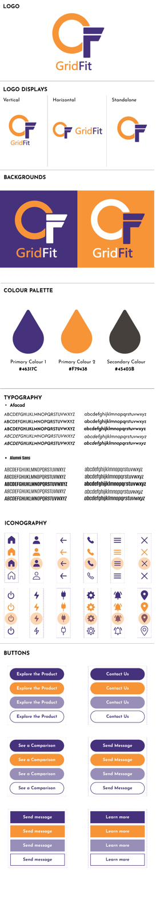

# Brand Guideline

The visual rules for anything GridFit: the app, the informational site, slides, and these docs.

{ width="320" }

## Logo

The logo is an orange open ring with a purple "F" sitting inside its opening. It comes in three layouts:

| Layout | When to use it |
|---|---|
| Vertical | Mark above the "GridFit" wordmark. Default for square spaces. |
| Horizontal | Mark beside the wordmark. Headers and wide banners. |
| Standalone | Mark on its own. App icons, favicons, small spaces. |

On a purple background the "F" and wordmark go white and the ring stays orange. On an orange background the ring and "Grid" go white and the "F" stays purple.

!!! warning "TODO"
    Replace the logo files in `docs/assets/images/` with the real exported SVGs. The ones there now are stand-ins redrawn for the scaffold.

## Colour palette

| Swatch | Name | Hex |
|---|---|---|
|  | Primary colour 1 | `#46317C` |
|  | Primary colour 2 | `#F79438` |
|  | Secondary colour | `#45403B` |

## Typography

| Typeface | Used for |
|---|---|
| Afacad | Body text, UI text |
| Alumni Sans | Headings and display text |

Both come in regular, medium, bold, italic and bold italic.

## Iconography

Line-style icons in four states: purple filled, orange filled, filled inside a light orange circle (active/selected), and outline. The set covers home, profile, back, call, menu, close, power, energy, plug, settings, alerts and location.

## Buttons

Pill-shaped and rectangular buttons, each in four states:

| State | Style |
|---|---|
| Default | Purple fill, white text |
| Hover / highlight | Orange fill, white text |
| Disabled | Light purple fill, white text |
| Secondary | White fill, purple outline and text |
