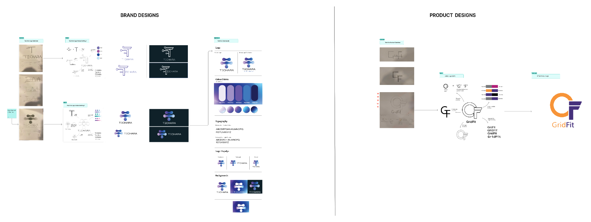

# Brand Guideline

This section defines the visual identity of **TechAra GridFit** and explains how the brand should be applied across its technical documentation and product interface. It connects the approved brand assets and visual references with frontend implementation.

GridFit is a rules-based fit-check platform that helps assess whether a small or medium-sized business's electricity demand can be matched to available mini-grid capacity. Its visual identity should communicate clarity, confidence, energy, and practical decision support.

> **Implementation note:** Brand references and frontend implementation are not automatically the same thing. The values below document the established GridFit identity. Where a production implementation detail has not been verified, this guide says so rather than assuming it is already present.

## Design Source Files

The supplied TechAra/GridFit design board is the primary visual reference for this guideline. It brings together the **TechAra brand designs** on the left and the **GridFit product identity** on the right.

| Asset | Purpose | Repository path |
| :--- | :--- | :--- |
| TechAra and GridFit design board | Combined brand and product-design reference | `docs/assets/images/techara-gridfit-brand-reference.png` |
| GridFit mark exports | Individual logo files, if present in the repository | Verify the actual filenames in `docs/assets/images/` |
| Favicon | Browser and tab identity, if supplied | Verify the actual filename in `docs/assets/images/` |

The combined design board is included with this guideline package. Individual logo exports and favicon paths should be checked against the current repository before they are documented as available assets.

## 1. Logos

The GridFit identity is built around an **orange open ring and a purple “F”**. The ring provides the energy and connection motif, while the letterform makes the mark distinctive and recognizable.

### GridFit Primary Mark

The primary symbol combines the orange open ring with the purple “F”. Use the primary mark where the background provides enough contrast for both colours to remain clear.

### Logo Variations

The identity includes variations intended for different layouts and background contexts:

- **Standalone mark:** use the symbol where space is limited, such as compact navigation or an application icon.
- **Horizontal layout:** use where the symbol and product name need to sit side by side.
- **Vertical layout:** use where a stacked brand arrangement is more suitable.
- **Light-background variant:** use the supplied alternative mark where the standard mark does not provide sufficient contrast.

Do not recreate, stretch, rotate, recolour, or rearrange the logo elements manually. Use the supplied exported assets. Confirm the approved horizontal and vertical lockup files before using them in a production interface; the repository mark alone should not be treated as proof that every lockup export is available.

<small>Reference board: TechAra brand-design explorations are shown on the left; GridFit product-logo development and the selected orange-and-purple mark are shown on the right.</small>

### Logo Usage

- Preserve the original proportions and spacing.
- Keep the mark clear of surrounding text and interface controls.
- Use a background that provides sufficient contrast.
- Do not add shadows, outlines, gradients, or effects unless they are part of an approved asset.
- Do not use the light-background variant on a surface where its elements become difficult to distinguish.
- Do not substitute a typed letter “F” or a newly drawn ring for the supplied mark.

## 2. Style Guide

GridFit uses a focused palette and a dual-font system. Purple provides the main brand identity, orange highlights actions and energy, and charcoal supports readable supporting text.

### Brand Style

The visual language should feel:

- **Clear:** information and decisions should be easy to scan.
- **Confident:** important statuses and actions should be visually distinct.
- **Practical:** the interface should support field and operational tasks rather than decorative presentation.
- **Consistent:** colour, typography, buttons, and icons should behave predictably across screens.

### Typography

GridFit uses **Alumni Sans** for display and heading text and **Afacad** for body and interface text.

| Usage | Font family | Application |
| :--- | :--- | :--- |
| Display / headings | Alumni Sans | Page titles, section headings, and prominent labels |
| Body / UI | Afacad | Paragraphs, form labels, buttons, helper text, and data values |

Use a clear hierarchy. Headings should establish the page structure, while body text should remain readable at normal interface sizes. Avoid using display typography for long paragraphs, form instructions, or dense data.

The repository's configured font loading and actual rendered weights should be checked in the frontend before changing typography tokens. This guide does not prescribe font weights that have not been verified.

### Color Palette

The established GridFit brand palette is:

| Colour | Hex value | Intended role |
| :--- | :--- | :--- |
| Purple | `#46317C` | Primary brand colour and key identity elements |
| Orange | `#F79438` | Accent colour and emphasis for important actions |
| Charcoal | `#45403B` | Supporting text and dark neutral elements |

Use the colours consistently and preserve readable contrast between text, controls, and their backgrounds. Orange should provide emphasis rather than being used indiscriminately for large blocks of text. Purple should remain recognizable as the primary brand colour.

These are the documented brand values. Before changing CSS variables or Tailwind tokens, compare them with the current frontend source and approved design references. Do not assume that every colour is already configured as a reusable token.

### Buttons and Actions

Buttons should make the available action clear. Use concise action labels and maintain consistent sizing, spacing, and interaction states.

- Use the primary brand treatment for the most important action on a screen.
- Use the accent colour deliberately to draw attention to a key action or state.
- Keep secondary actions visually quieter than the primary action.
- Ensure button text has sufficient contrast against its background.
- Provide visible hover, focus, disabled, and loading states where the component supports them.
- Do not communicate a status through colour alone; include a readable label or other clear indicator.

The exact button variants, dimensions, and state colours should be taken from the approved UI designs and verified against the frontend components. This page does not claim that a complete shared button component system has been implemented.

### Iconography

Use icons to support recognition and scanning, not as a replacement for clear labels. Keep icon style, stroke weight, and sizing consistent within a screen.

The frontend uses the `lucide-react` icon library. Prefer its existing icons over introducing a second icon set for similar interface actions. Use text labels alongside icons where the meaning may not be immediately obvious, especially for important actions and status indicators.

### Backgrounds and Surfaces

Backgrounds and content surfaces should make the information hierarchy easy to understand. Use the approved screen designs as the reference for surface colours, borders, and elevation.

Avoid adding new background colours or decorative effects without checking the established design references. The palette listed in this guide records the confirmed brand colours; it does not define a complete set of background, border, or semantic status tokens.

## 3. Product Experience

GridFit's product interface supports the field workflow for recording a business and preparing its equipment and meter information. The documented field experience contains four connected screens.

### Field Home

The Field Home screen is the starting point for the field workflow. Its visual design should make the next available task easy to identify and provide a clear entry into business registration.

### Log a Business

The Log a Business screen captures the business information needed to begin the workflow. Form labels, required-field indicators, helper text, and validation messages should use the same typography and colour rules as the rest of the product.

### Equipment List

The Equipment List screen records the equipment associated with the business. Information should be grouped and labelled clearly so that a field user can review entries without confusion.

### Install Meter

The Install Meter screen represents the meter-installation stage of the workflow. The interface should distinguish information that has been recorded from actions that depend on a registered physical device or backend capability.

These descriptions identify the documented screen scope; they are not a claim that every possible meter operation is currently available in production.

## 4. Interface Reference

Use the combined design board below as the visual reference. The left side documents the TechAra brand exploration and identity; the right side documents the GridFit product logo exploration and final mark. Treat the GridFit product identity as the direct reference for GridFit documentation and interface work.

  
  

The field workflow should retain a consistent visual language across all four screens:

- consistent page titles and section headings;
- consistent form labels, inputs, and validation messages;
- consistent primary and secondary action treatments;
- consistent icon sizing and alignment;
- clear status text and feedback;
- readable spacing and contrast.

If the repository contains updated screenshots or approved design exports, add them to this section using their actual repository paths. Do not use placeholder images or screenshots from unrelated products.

## 5. Implementation Guidance

The brand guideline should be used alongside the frontend technical documentation and the actual frontend source code.

### Frontend References

- [Frontend Web](frontend-web.md) — frontend structure, setup, and implementation details.
- [Developer Guide](developer-guide.md) — development workflow, testing, and contribution practices.

### Applying the Brand in Code

When updating the interface:

1. Reuse the supplied logo assets instead of recreating the mark.
2. Reuse the established font configuration where it is already available.
3. Check existing colour definitions before introducing new values.
4. Keep buttons, form controls, and icons consistent across the field screens.
5. Verify contrast and legibility at the actual rendered size.
6. Check the interface at the screen sizes used by field teams.
7. Update this guide when an approved brand asset or design token changes.

### Verification Checklist

Before considering a visual change complete, confirm that:

- [ ] The correct GridFit logo asset is used.
- [ ] The logo proportions and colours have not been altered.
- [ ] Alumni Sans is used for headings where configured.
- [ ] Afacad is used for body and interface text where configured.
- [ ] The documented brand colours match the approved source.
- [ ] Buttons have clear labels and distinguishable interaction states.
- [ ] Icons are consistent and do not replace essential labels.
- [ ] Text and controls have sufficient contrast.
- [ ] The four field workflow screens remain visually consistent.
- [ ] The page builds successfully with `mkdocs build --strict`.

## 6. Summary

GridFit's visual identity is centred on the orange open ring and purple “F”, supported by a purple, orange, and charcoal palette. Alumni Sans provides the display and heading style, while Afacad supports readable body and interface text.

The brand assets and values in this guide provide a shared reference for documentation and frontend work. Always verify the current asset paths, approved design exports, and frontend implementation before making changes. The brand guideline should evolve with approved design decisions while keeping the GridFit product recognizable and consistent.
