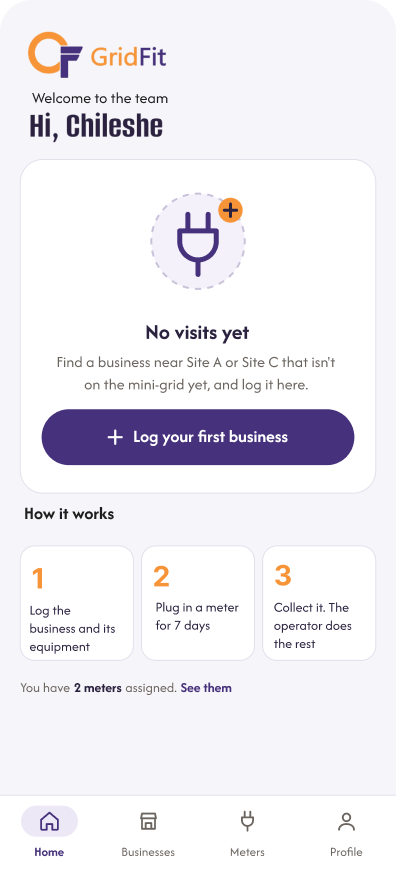
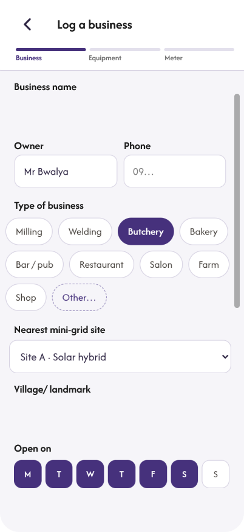
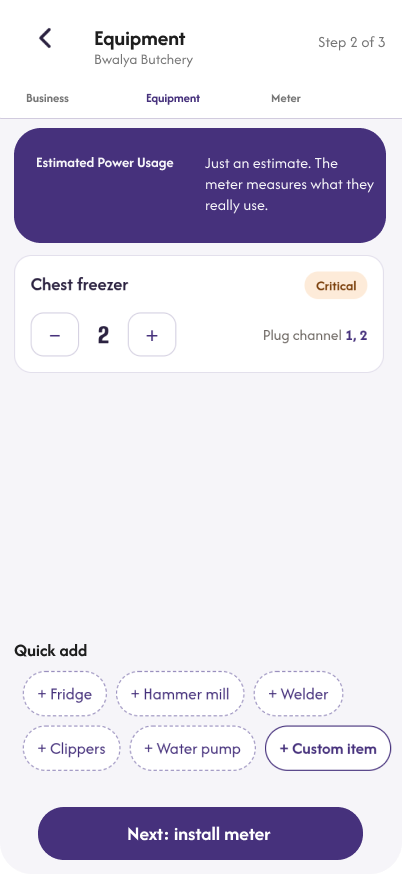
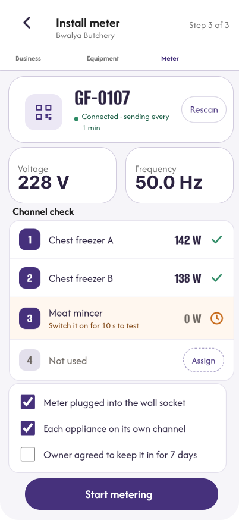
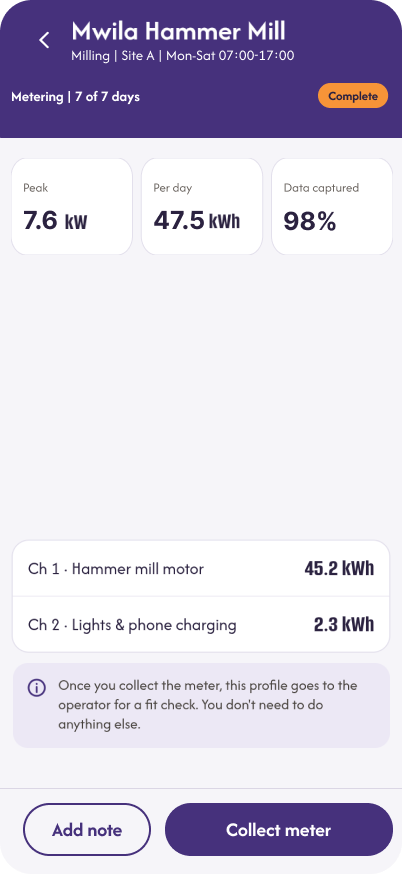
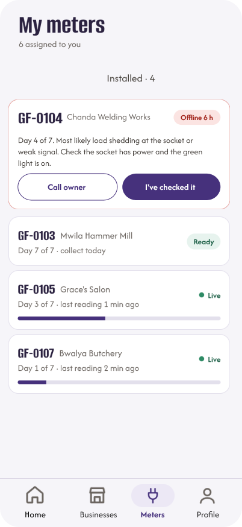

# Field Application

The GridFit field application is the interface intended for field agents who collect business and equipment information and manage meter-related activities.

It is built with Next.js and React and provides a mobile-oriented workflow for capturing information about prospective productive-use businesses.

## Overview

The field application supports the collection of business information, equipment details and meter assignments.

Its main purpose is to help field agents capture structured information that can contribute to the operator's business and site assessment workflow.

## Routes

The field application uses the `/field` route area.

The main routes include:

| Route | Purpose |
|---|---|
| `/field/home` | Field agent home screen |
| `/field/log` | Business registration |
| `/field/log/equipment` | Equipment information |
| `/field/log/meter` | Meter installation workflow |
| `/field/businesses` | Business records |
| `/field/meters` | Meter management |

Refer to the frontend source for the latest route definitions.

## Field workflow

The main business registration workflow consists of three stages:

1. **Log a business:** Capture the business details.
2. **Record equipment:** Add the equipment used by the business.
3. **Install a meter:** Record the meter installation information and associate it with the business.

The collected information supports subsequent business monitoring and assessment workflows.

## Field application design references

The following screenshots are taken from the GridFit Figma design files. They illustrate the intended field application experience and should be treated as design references rather than proof of complete implementation.

### Field Home

### Log a Business

### Equipment List

### Install Meter

### Business Metering

### Meter Management

## Installing the PWA

The frontend includes a web application manifest intended to support installation metadata.

To install the application on a supported mobile browser:

1. Open the deployed GridFit application in the browser.
2. Open the browser menu.
3. Select **Install app** or **Add to Home Screen**, if available.
4. Follow the browser instructions.

Installation availability depends on the browser, device and deployment configuration.

The presence of a manifest does not independently confirm that every PWA installation requirement has been implemented.

## Offline behaviour

Offline operation has not been confirmed as fully implemented.

The frontend contains a PWA manifest, but a service worker has not been confirmed in the inspected source. Field agents should therefore use a reliable network connection when registering businesses, recording equipment or managing meters.

Do not assume that submitted information will be stored or synchronised automatically when offline.

## Troubleshooting

| Issue | Recommended action |
|---|---|
| Application does not load | Check the internet connection and reload the page. |
| Installation option is unavailable | Confirm browser support and deployment configuration. |
| Business information is not displayed | Refresh the application and verify the selected business. |
| Meter information is missing | Check the business and meter assignment details. |
| Form submission fails | Review required fields and retry when connectivity is available. |
| Application displays unexpected behaviour | Record the issue and report it to the development team. |

