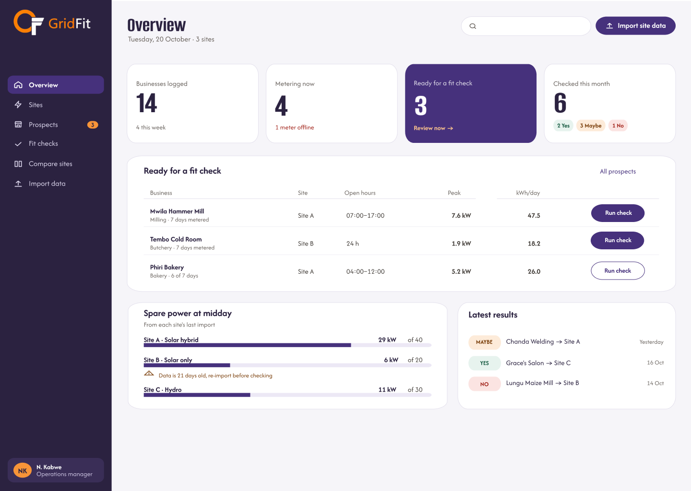
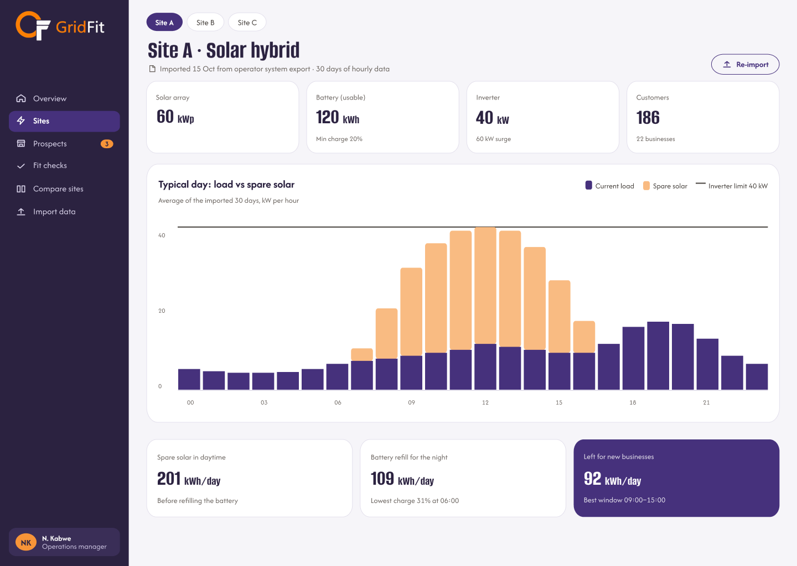
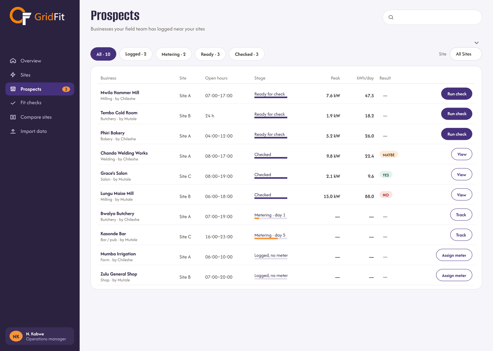
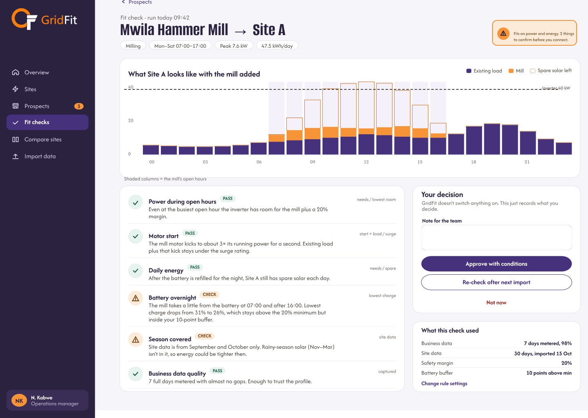
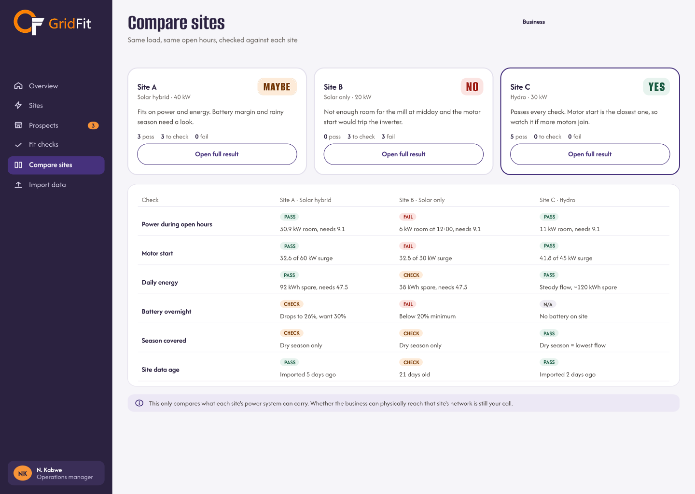
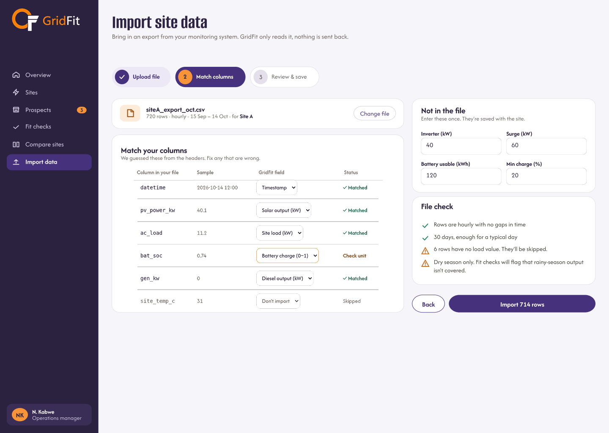
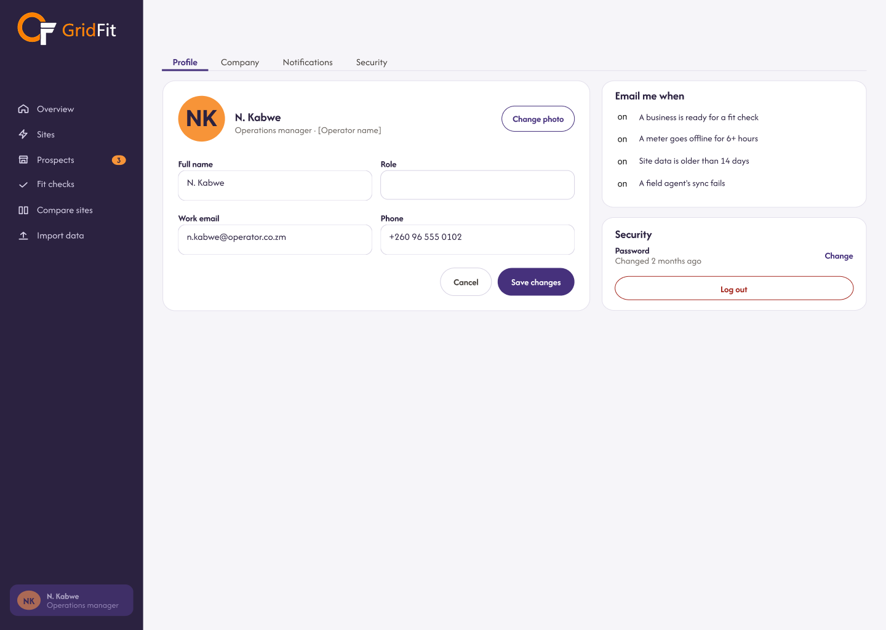

# Frontend Web

The GridFit frontend is a web application built with Next.js and React. It provides two interfaces: an operator dashboard for reviewing mini-grid sites and business prospects, and a field application for collecting business, equipment and meter information.

The frontend currently uses mock data to demonstrate the main workflows. It is not yet fully connected to the backend API.

## Technology stack

| Technology | Purpose |
|---|---|
| Next.js 16.4.3 | Application framework |
| React 19.3.0 | User interface |
| TypeScript | Typed frontend utilities |
| JavaScript | Page and component implementation |
| CSS Modules | Component and page styling |
| Lucide React | Icons |
| Radix UI Dialog | Dialog interface components |
| React Hook Form | Form management |
| Vitest | Test runner configuration |

## Prerequisites

Before running the project, install:

- Node.js and npm.
- Git.
- A code editor such as Visual Studio Code.

The repository does not specify a required Node.js version. Use a version compatible with the installed Next.js release.

## Setup and installation

Clone the frontend repository and enter its directory:

\`\`\`bash
git clone <frontend-repository-url>
cd techara-frontend
\`\`\`

Install dependencies:

\`\`\`bash
npm install
\`\`\`

Start the development server:

\`\`\`bash
npm run dev
\`\`\`

Open http://localhost:3000 in a browser.

The operator dashboard is available from the main application routes, while the field application is available under `/field`.

## Project structure

The frontend uses the Next.js App Router.

The main application areas include:

- **App routes:** Define dashboard and field application pages.
- **Components:** Provide reusable interface elements.
- **Styles:** Contain global and component-specific CSS.
- **Utilities:** Support shared frontend operations and API communication.
- **Public assets:** Store static images, icons and application resources.

Refer to the frontend repository for the complete directory structure.

## Pages and features

The operator dashboard provides the following main areas:

| Page | Purpose |
|---|---|
| Overview | Presents a summary of the operator's GridFit workspace. |
| Sites | Provides access to registered mini-grid sites. |
| Prospects | Supports review of prospective businesses. |
| Fit Check | Provides access to business feasibility assessments. |
| Compare Sites | Supports comparison of available site information. |
| Import Data | Provides an interface for importing site data. |
| Profile Settings | Provides user profile and account settings. |

The field application supports business registration, equipment recording, meter installation and meter management.

These pages describe the frontend interface. Some workflows currently use mock data and should not be interpreted as fully integrated backend functionality.

## Dashboard design references

The following screenshots are design references from the GridFit Figma files. They illustrate the intended dashboard layout and visual hierarchy; they do not independently confirm that every screen is fully implemented.

### Overview

### Sites management

### Prospects

### Fit Check

### Compare Sites

### Import Data

### Profile Settings

## API integration

The frontend contains shared API utilities and request-handling logic. However, the current application uses mock data and is not fully integrated with the backend.

Before enabling production integration, the frontend must use the configured backend API base URL, handle authentication credentials securely and process API responses consistently.

See [Backend API](backend-api.md) for the backend endpoint documentation.

## Authentication flow

The current frontend includes login and account interface screens. The login experience is simulated and should not be treated as production authentication.

Production authentication must integrate with the backend authentication endpoints and enforce access to protected application routes.

## Styling and design system

The frontend uses CSS Modules and global CSS for styling. The GridFit visual identity uses purple, orange and dark neutral colours.

See [Brand Guidelines](brand-guideline.md) for the visual identity, colour palette, typography and logo references.

## Error handling

Frontend forms and API interactions should provide clear feedback for:

- Required or invalid form fields.
- Failed requests.
- Missing or unavailable records.
- Loading and empty states.
- Unexpected application errors.

Production API integration should ensure that errors are presented clearly without exposing sensitive backend information.

## Quality assurance

Vitest is configured as the frontend test runner. The existence of this configuration does not by itself confirm that all frontend workflows have automated test coverage.

Frontend verification should include navigation, form validation, responsive layouts, error states and integration with backend endpoints when available.

See [QA Process](qa-process.md) for the wider quality assurance approach.

## Deployment

The frontend is a Next.js application.

The production build command is:

\`\`\`bash
npm run build
\`\`\`

To start the production server after a successful build:

\`\`\`bash
npm run start
\`\`\`

The deployment environment must provide the required application configuration and backend API settings. The hosting provider and production deployment configuration should be confirmed from the deployment environment before release.
