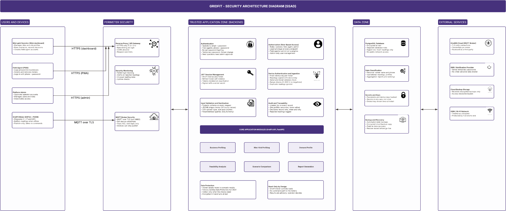

# Security

GridFit manages user accounts, organisation records, business-owner contact details, mini-grid site profiles, scenarios and meter assignments. These records can contain personal information and commercially sensitive operational data. Access must be limited to authenticated users acting within their assigned role and organisation.

The FastAPI backend is the primary security boundary. Hiding a button or screen in the frontend does not enforce authorization. This page describes controls visible in the supplied GridFit backend and frontend source, identifies gaps, and separates implemented controls from safeguards that are not demonstrated in the source.

## Security architecture

GridFit separates the browser and field application from the backend API and database. The frontend sends requests to the backend; the backend authenticates the user, checks route permissions, validates input and applies organisation-scoped service queries.



The architecture image describes the security boundaries. It should not be read as proof that every control is implemented or enabled in production. The status table below reflects the source inspected for this documentation.

## Status of controls

| Area | Control | Status |
|---|---|---|
| Authentication | Password hashing with `pwdlib` recommended password hasher | Implemented |
| Authentication | Login using email address or phone number | Implemented |
| Authentication | HS256 JWT with subject, role, organisation and expiry claims | Implemented |
| Authentication | Configurable access-token lifetime; 60-minute default | Implemented |
| Authentication | Required `JWT_SECRET` | Implemented; minimum length is not checked in supplied source |
| Authentication | Temporary-password enforcement | Implemented in `core.dependencies`; inconsistent across routers |
| Authentication | Refresh-token rotation and server-side token revocation | Not implemented in supplied source |
| Authorization | Role checks for protected business, site, scenario and assignment routes | Partially implemented; dependency inconsistency remains |
| Authorization | Organisation-scoped access to core business and meter-assignment records | Implemented in inspected services |
| Authorization | Authentication and role checks on sensor-device registry routes | Missing in supplied router |
| Data protection | Passwords stored as hashes | Implemented |
| Data protection | Meter-assignment token stored as a SHA-256 hash | Implemented |
| Data protection | Frontend access-token cookie marked HttpOnly and SameSite | Implemented in supplied frontend login route |
| Data protection | HTTPS redirect, HSTS and security headers | Not demonstrated in supplied application source |
| Application security | Pydantic request validation | Implemented in inspected schemas |
| Application security | CORS allow-list and request rate limiting | Not demonstrated in supplied application source |
| Audit | Central audit trail for sensitive changes | Not demonstrated in supplied application source |
| Device security | Authenticated reading-ingestion endpoint and device-token verification | Not present in supplied application |
| Operations | Backup, restore testing and central security monitoring | Not demonstrated in supplied application source |

## Authentication

GridFit uses password-based authentication. The backend accepts an email address or phone number as the login identifier. A successful login returns a bearer access token.

### Passwords

The authentication service uses `pwdlib`'s recommended password-hashing configuration:

```python
from pwdlib import PasswordHash

password_hasher = PasswordHash.recommended()
```

The signup service hashes the password before saving the user record. During login, the supplied password is checked against the stored hash; the original password is not stored.

Signup and password-change schemas accept passwords between 8 and 128 characters. The inspected source does not enforce a separate complexity rule for uppercase letters, numbers or symbols.

### Login

`POST /auth/login` accepts an `identifier` and `password`. If the identifier contains `@`, the service looks up the user by email; otherwise, it looks up the user by phone number. Unknown users, inactive users and incorrect passwords are rejected with `401`.

### Access tokens

Access tokens are JSON Web Tokens signed with HS256. The payload includes:

| Claim | Meaning |
|---|---|
| `sub` | User UUID |
| `role` | User role at token creation |
| `org` | Organisation UUID |
| `exp` | Token expiry time |

The access-token lifetime is controlled by `ACCESS_TOKEN_MINUTES` and defaults to 60 minutes:

```python
def get_token_minutes():
    return int(os.getenv("ACCESS_TOKEN_MINUTES", "60"))
```

`JWT_SECRET` is required when a token is created or decoded. The application raises a runtime error if it is missing. The supplied `core/security.py` does not enforce a minimum secret length; production must use a strong, randomly generated secret stored outside source control.

The supplied implementation does not include refresh-token rotation or a server-side token denylist. Each protected request reloads the user record and rejects an inactive account, so deactivating a user prevents that user from making further authenticated requests.

### Authenticated requests

The backend reads the bearer token from the `Authorization` header, verifies its signature and expiry, extracts the user UUID from `sub`, and loads the user from the database. Missing, invalid or expired credentials are rejected with `401`. A missing user or inactive account is also rejected.

```python
user = db.get(User, user_id)

if user is None or not user.is_active:
    raise HTTPException(
        status_code=status.HTTP_401_UNAUTHORIZED,
        detail="Invalid or expired token",
    )

return user
```

### Temporary passwords

`core.dependencies` defines `require_password_changed`. It returns `403` when `must_change_password` is still set, requiring the user to change the temporary password before continuing to protected operations.

There is an inconsistency in the supplied source: several routers use `require_roles` from `core.dependencies`, while the site and site-profile routers import it from a separate top-level `dependencies.py`. That second implementation does not apply the temporary-password check. The dependency implementations should be consolidated so that the same checks apply to every protected route.

## Authorization

Authorization is enforced through authenticated-user dependencies, role checks and organisation-scoped service queries. The backend defines two operational roles: `OPERATOR` and `FIELD_AGENT`.

### Role permissions

| Capability | Operator | Field agent |
|---|---:|---:|
| Create and update sites | Yes | No |
| View organisation sites | Yes | Yes |
| Manage site profiles | Yes | No |
| Create and manage business records | Yes | Yes, subject to record-level restrictions |
| Run and manage scenarios | Yes | No |
| Install a meter assignment | Yes | Yes |
| Remove a meter assignment | No | Yes |
| List and retrieve meter assignments | Yes | Yes |
| Register, list or update sensor devices | No consistent route-level protection in supplied router | No consistent route-level protection in supplied router |

A caller who is authenticated but does not have the required role should receive `403`. The table reflects route dependencies in the inspected source and is not a production permissions certification.

### Organisation and record ownership

Core services use the authenticated user's `organisation_id` when retrieving organisation-owned records. Meter installation checks that the selected device and business belong to the current user's organisation before creating an assignment.

Business creation also derives the organisation-owned site from the authenticated user and records that user's ID as `logged_by`. Field agents can update only their own prospective business records; records outside that rule are returned as not found.

Do not trust a client-supplied organisation identifier when the authenticated user context is available. Every new repository query and service operation must preserve the organisation boundary.

### Sensor-device routes — unresolved gap

The supplied `routers/sensor_devices.py` does not declare `get_current_user` or `require_roles` dependencies on its register, list or status-update endpoints. Registration accepts `organisation_id` and `registered_by` from the request body. Listing and status updates accept an `organisation_id` request parameter.

The router therefore does not enforce the same authenticated organisation boundary used by the core business and assignment services.

Before production:

1. Require an authenticated user on every sensor-device management endpoint.
2. Derive `organisation_id` and `registered_by` from the authenticated user rather than trusting request input.
3. Define which role can register, list and change device status.
4. Add tests proving anonymous requests are rejected and users cannot access another organisation's devices.
5. Review the route and service changes with the backend team.

## Known security finding: sensor-device route protection

The supplied backend route file `techara-backend/routers/sensor_devices.py` does not apply the same authenticated-user and role-based dependency checks used by the protected business, site, scenario and assignment routes. The router exposes device registration, listing and status updates without the `Depends(require_roles(...))` pattern used elsewhere.

This is a known security finding in the current implementation. The implications are significant:

- unauthenticated or insufficiently authorised callers may be able to reach device-management functions;
- organisation ownership and device registration can be driven by request-supplied values instead of the authenticated user context;
- the backend cannot claim uniform route protection until this inconsistency is remediated.

The route must be remediated before production use. The current state is therefore: `Partially Verified` for authorization enforcement on the whole API, with this sensor-device route explicitly marked as a remaining security gap.

## Data Protection

### Data classification

| Data | Examples | Handling |
|---|---|---|
| Account credentials | Passwords, password hashes and access tokens | Never expose in API responses, logs or source control |
| Personal information | Names, email addresses and phone numbers | Limit access to users with an operational need |
| Business information | Business names, owner contacts, operating hours and equipment | Restrict access to authorised users in the owning organisation |
| Site and energy information | Site profiles, available capacity, tariffs and demand estimates | Treat as commercially sensitive operational data |
| Metering information | Device identifiers, assignments, readings and timestamps | Preserve ownership, installation association and data provenance |
| Device credentials | Raw installation token and stored token hash | Show the raw token only when issued; never log or commit it |

### Database

The backend obtains its database connection string from `DATABASE_URL`. The inspected `database.py` loads local environment configuration and creates a SQLAlchemy engine.

Database credentials must be supplied through environment configuration and must not be committed to the repository. The supplied source does not demonstrate database encryption-at-rest configuration, database-level row security, automated backup scheduling or a tested restore process. These controls must be verified in the hosting and database environment.

### In transit

The supplied FastAPI application does not demonstrate HTTPS redirection, HSTS or transport-security headers in its application setup. The frontend's server-side proxy makes backend requests, but that alone does not prove that the deployed system enforces TLS.

Production deployment must use HTTPS for browser-to-frontend and frontend-to-backend communication. Confirm TLS termination, trusted proxy handling and security headers in the hosting or reverse-proxy configuration.

### Frontend token storage

The supplied Next.js login route stores the access token in a cookie named `techara_access_token`. The cookie is configured with:

| Setting | Value | Purpose |
|---|---|---|
| `httpOnly` | `true` | Prevents browser JavaScript from reading the cookie |
| `sameSite` | `lax` | Applies same-site cookie restrictions |
| `secure` | `true` in production | Sends the cookie only over secure connections |
| `path` | `/` | Makes the cookie available to the application paths |
| `maxAge` | 60 minutes when keep-logged-in is selected | Sets the cookie lifetime for that option |

The backend proxy reads the cookie server-side and forwards the token as a Bearer authorization header. The frontend proxy uses `cache: "no-store"` for backend requests.

### Meter-assignment credentials

When a meter is assigned, the service generates a random URL-safe token and stores its SHA-256 hash. The raw token is returned in the assignment-created response; the normal assignment read schema does not expose it.

```python
def generate_device_token():
    return secrets.token_urlsafe(32)


def hash_device_token(token):
    return hashlib.sha256(token.encode()).hexdigest()
```

The supplied backend does not register a reading-ingestion router in `main.py`, and no supplied endpoint verifies a device token and accepts authenticated telemetry. Generating an installation token is not, by itself, proof of end-to-end device authentication.

Before physical readings are accepted, the backend must verify the installation-specific token, bind each reading to the correct active assignment and test invalid, expired, replayed and duplicate submissions.

## Application Security

### Input validation

FastAPI request bodies are validated with Pydantic schemas. The inspected schemas define required fields, string length limits, email validation, enumerated role and status values, and numeric constraints where applicable. SQLAlchemy models also define database constraints for important record relationships and values.

Frontend validation improves usability but is not a security boundary. The backend must validate every request because callers can bypass the GridFit interface and send requests directly to the API.

### Error handling

The application registers exception handlers in `main.py`. Review the deployed error responses to ensure that clients do not receive stack traces, SQL statements, database connection strings, passwords or tokens. The inspected source does not establish that every unexpected error is handled through a centrally documented safe-error format.

### Logging and audit

The supplied authentication dependency contains a diagnostic `print` statement that reports whether a user was found and whether the account is active. It does not print the password or bearer token, but it is development-oriented output and should be replaced with structured, appropriately filtered logging before production.

A central audit trail for sensitive changes is not demonstrated in the supplied application source. The team should define audit events for account changes, business updates, site-profile changes, meter-assignment lifecycle events and device-status changes. Audit entries should identify the actor, role, organisation, action, affected record and timestamp without storing secrets.

### Request abuse controls

The supplied application source does not demonstrate request rate limiting for login or other sensitive endpoints, nor does it demonstrate an application-level CORS allow-list. Review CORS, trusted-host and proxy settings, and add appropriate rate limits at the API or deployment edge before production.

## Integrations

The inspected GridFit source demonstrates a frontend-to-backend API connection and a database connection configured through environment variables. It does not provide sufficient evidence to document a production external-provider integration catalogue.

| Integration boundary | Evidence in supplied source | Security consideration |
|---|---|---|
| Next.js frontend to FastAPI backend | Server-side proxy forwards the access token as a Bearer header | Keep `BACKEND_URL` server-side; use HTTPS in production |
| FastAPI backend to database | SQLAlchemy connection configured through `DATABASE_URL` | Keep credentials out of source control and restrict database network access |
| Physical meter to reading-ingestion API | No registered ingestion endpoint or token-verification handler found | Do not treat device telemetry as authenticated until this boundary is implemented and tested |

Do not describe MQTT, SMS, email, cloud hosting or other providers as active integrations unless the maintained deployment configuration and source confirm them.

## Incident Handling

### Detect

Investigate reports of unexpected access, account compromise, exposed credentials, suspicious device activity or unexpected changes to organisation records. The supplied source does not demonstrate centralized security monitoring or automated security alerts.

### Contain

| Situation | Immediate action |
|---|---|
| A user account may be compromised | Deactivate the account and review access to its organisation's records |
| `JWT_SECRET` may be exposed | Replace it in the deployment environment; tokens signed with the previous secret will no longer validate |
| Database credentials may be exposed | Rotate the credentials and review database access |
| A meter-assignment token may be exposed | Disable or replace the affected assignment credential through a supported backend operation |
| Business or site data may have been changed improperly | Restrict affected access and preserve relevant application and database evidence |

### Investigate and recover

1. Preserve application, hosting and database logs relevant to the incident.
2. Identify affected accounts, organisations and records.
3. Determine whether personal information, business information or device credentials were exposed.
4. Restore data only from a verified backup and follow the responsible data owner's approval process.
5. Fix the root cause and add a regression test before redeployment.
6. Record the incident, decisions and follow-up work with the responsible project owners.

The supplied source does not demonstrate a complete incident-management runbook, central alerting, backup retention policy or tested restore procedure. These operational controls must be defined and exercised before production reliance.

## Environment variables

| Variable | Required | Purpose |
|---|---|---|
| `JWT_SECRET` | Yes | Signs and verifies access tokens; use a strong random value |
| `ACCESS_TOKEN_MINUTES` | No | Sets access-token lifetime; defaults to 60 minutes |
| `DATABASE_URL` | Yes | Configures the backend database connection |
| `BACKEND_URL` | Yes for frontend proxy operation | Server-side destination for backend API requests |
| `NEXT_PUBLIC_API_URL` | Used by browser-side API helpers | Public browser configuration; never place secrets in this variable |

Keep secrets in deployment environment configuration or an approved secret store, not in Git. The `NEXT_PUBLIC_` prefix exposes a value to the browser bundle, so it must never contain credentials or private tokens. Use separate credentials and databases for development, test and production. Rotate any credential that has been exposed; deleting it from the latest commit does not make it safe again.

## Production security checklist

- [ ] Protect sensor-device registration, listing and status routes with authentication and role checks.
- [ ] Derive device organisation and registering-user identifiers from the authenticated principal.
- [ ] Consolidate role-dependency implementations and enforce temporary-password checks consistently.
- [ ] Add cross-organisation authorization tests for every organisation-owned resource.
- [ ] Implement and test device-token verification before accepting physical meter readings.
- [ ] Configure a strong `JWT_SECRET` outside source control.
- [ ] Confirm HTTPS/TLS, secure cookies and security headers at the production edge.
- [ ] Review CORS, trusted proxy configuration and request rate limiting.
- [ ] Replace development diagnostic output with structured security logging.
- [ ] Define audit logging for sensitive account and operational changes.
- [ ] Confirm database access restrictions, backup retention and restore procedures.
- [ ] Review token expiry, revocation and account-recovery requirements.
- [ ] Complete a security review of the deployed system and its external integrations.

## Summary

The supplied GridFit implementation includes password hashing, HS256 bearer tokens, active-account checks, role dependencies, organisation-scoped service operations, frontend HttpOnly cookie storage and hashed meter-assignment tokens. The most significant implementation gaps are the unauthenticated sensor-device registry routes, inconsistent temporary-password enforcement and the absence of a device-token-verified reading-ingestion endpoint. HTTPS enforcement, CORS policy, rate limiting, audit logging, backup recovery and production monitoring are not demonstrated in the supplied source and must be verified or implemented before production use.
